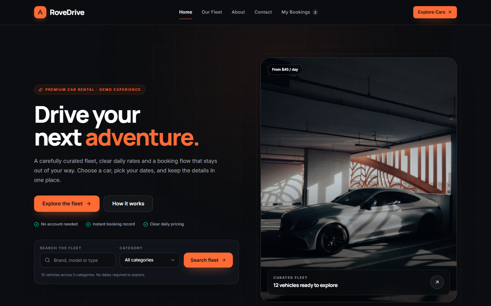
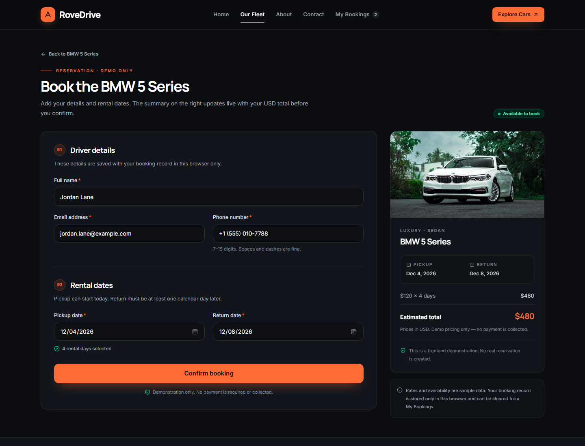
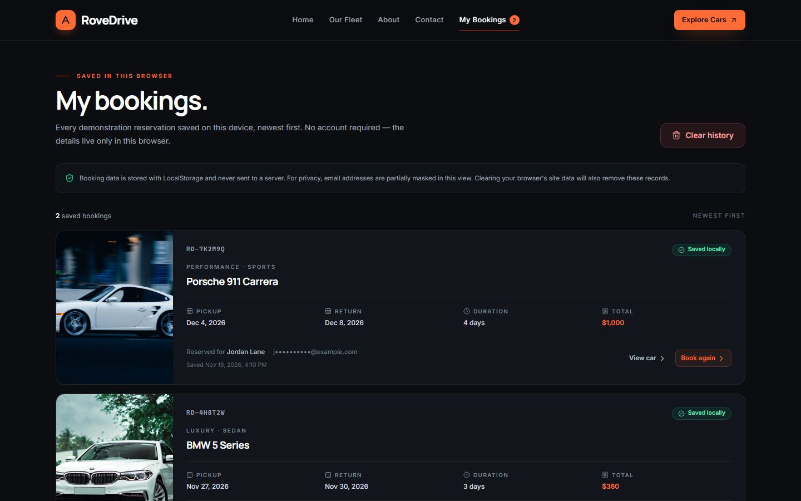

# RoveDrive

**Drive Your Next Adventure.**

RoveDrive is a responsive, portfolio-quality car rental front-end built with React, Vite and Tailwind CSS. It pairs a premium dark automotive design with a complete demonstration booking flow: fleet search and filtering, vehicle detail pages, date-based pricing, validated reservations, LocalStorage booking history and graceful empty/invalid states.

> **Demo notice:** RoveDrive is a fictional frontend demonstration. All vehicles, prices, availability, contact details and rental policies are sample content. No real reservation, payment or rental agreement is created, and no data is sent to a server.

---

## Preview

| Home | Fleet |
| --- | --- |
|  |  |

| Vehicle details | Booking |
| --- | --- |
|  |  |

| My bookings | Mobile |
| --- | --- |
|  |  |

---

## Highlights

- **12 curated vehicles** across five categories and three body types, centralised in one data module.
- **Combined fleet search**: keyword search, category, body type, maximum daily price, availability and sorting all work together.
- **Homepage search handoff**: keyword and category selections feed the fleet page through URL query parameters.
- **Complete vehicle detail pages**: specifications, equipment, sample rental terms, availability and related cars.
- **Validated booking flow**: custom name, email and phone checks; local-date validation; return-after-pickup enforcement; unavailable-car guards.
- **Live USD calculation** based on the selected dates and daily rate.
- **Unique booking references** with collision checks and duplicate-booking prevention.
- **Persistent booking history** in LocalStorage (`rovedrive.bookings.v1`), including cross-tab synchronisation.
- **Confirmation only for saved bookings**: the success page looks up a real saved reference through the URL.
- **Privacy-conscious history**: phone numbers are not shown and email addresses are masked.
- **Accessible interactions**: semantic landmarks, labelled fields, focus handling, focus-trapped confirmation dialogs, skip link and reduced-motion support.
- **Responsive at 375 / 768 / 1024 / 1440 px** with no horizontal overflow.

---

## Tech stack

| Area | Choice |
| --- | --- |
| UI | React 19 |
| Build tool | Vite 8 |
| Styling | Tailwind CSS 4 (`@tailwindcss/vite`) |
| Routing | React Router 7 |
| Icons | Lucide React |
| State | React Context API + component state |
| Persistence | Browser LocalStorage |
| Fonts | Inter + Manrope (Google Fonts) |

No backend, API, authentication, payment provider or database is involved.

---

## Getting started

### Prerequisites

- Node.js **20.19+** (or 22.12+)
- npm 10+

### Install and run

```bash
npm install
npm run dev
```

Open the local URL printed by Vite (usually `http://localhost:5173`).

### Production build

```bash
npm run build
npm run preview
```

The production output is written to `dist/`.

### Lint

```bash
npm run lint
```

---

## Routes

| Path | Purpose |
| --- | --- |
| `/` | Homepage: hero search, company intro, featured cars, benefits, how it works, CTA |
| `/fleet` | Full fleet with combined search, filters and sorting |
| `/cars/:id` | Vehicle details, specifications, features, rental information and booking CTA |
| `/booking/:id` | Reservation form, validation and live price summary |
| `/booking-success?ref=RD-XXXXXX` | Confirmation for a booking that exists in LocalStorage |
| `/my-bookings` | Saved booking history, empty state and confirmed clear-history action |
| `*` | Custom 404 page |

---

## Project structure

```text
rovedrive/
├─ public/
│  ├─ images/
│  │  ├─ cars/                 # 12 locally stored vehicle photos
│  │  └─ hero.jpg              # Hero photograph
│  ├─ favicon.svg
│  └─ _redirects               # Netlify SPA fallback
├─ src/
│  ├─ components/
│  │  ├─ booking/              # Form, live summary, saved booking card
│  │  ├─ cars/                 # Cards, grid, filters, search, sort, image
│  │  ├─ common/               # Button, modal, toast, empty state, heading
│  │  └─ layout/               # Navbar, footer, route layout + scroll manager
│  ├─ context/
│  │  ├─ BookingProvider.jsx   # Bookings state, persistence, cross-tab sync
│  │  └─ bookingContext.js     # Context object + useBookings hook
│  ├─ data/
│  │  ├─ cars.js               # Central inventory and helpers
│  │  └─ site.js               # Fictional contact details and demo notice
│  ├─ hooks/
│  │  ├─ useBodyScrollLock.js
│  │  ├─ useCarFilters.js      # Combined filtering, sorting and facets
│  │  └─ useDocumentTitle.js
│  ├─ pages/                   # One component per route
│  ├─ utils/
│  │  ├─ booking.js            # Validation, pricing, reference generation
│  │  ├─ dates.js              # Local date-only helpers
│  │  ├─ format.js             # Currency, date, mileage and masking helpers
│  │  ├─ cn.js                 # Conditional class names
│  │  └─ storage.js            # Safe LocalStorage reads/writes + validation
│  ├─ App.jsx                  # Route table
│  ├─ index.css                # Tailwind theme tokens and global styles
│  └─ main.jsx                 # BrowserRouter + BookingProvider
├─ index.html
├─ package.json
├─ package-lock.json
├─ vite.config.js
└─ vercel.json                 # Vercel SPA fallback
```

---

## How it works

### Fleet filtering pipeline

`useCarFilters` owns the filter state and derives results in this order:

1. **Search tokens** — every whitespace-separated token must appear in the car's brand, model, display name, category, body type or fuel type. This means `electric`, `SUV` and `hybrid` are useful searches too.
2. **Category** — `Luxury`, `Everyday`, `Performance`, `Electric` or `Economy`.
3. **Body type** — `Sedan`, `SUV` or `Sports`.
4. **Maximum daily price** — values above the selected budget are removed.
5. **Availability** — when enabled, only cars marked available remain.
6. **Sorting** — recommended order, price ascending, price descending or name A–Z.

Filters are combined, not applied one at a time. The active-filter count excludes the search query; the “Clear all” action resets both.

The homepage search form navigates to `/fleet?q=...&category=...`. The fleet page reads those parameters once as initial state, then keeps interaction local. This keeps the URL shareable without adding a two-way URL-sync layer.

### Booking lifecycle

1. The booking route checks the car ID and availability before rendering the form.
2. Controlled inputs update a shared values object and the live summary.
3. Submit runs custom validation for name, email, phone, pickup date, return date and vehicle state.
4. Invalid fields receive inline messages and the first invalid field is focused.
5. A duplicate check blocks a second booking with the same car, dates and email.
6. A submission lock (`useRef` plus a disabled button) blocks double submits.
7. A unique `RD-XXXXXX` reference is generated and checked against saved references.
8. A booking record with a small vehicle snapshot is written to LocalStorage **before** React state is updated.
9. If the write fails, the form shows the error and **no success page is shown**.
10. On success, the app navigates to `/booking-success?ref=...`.
11. The success page looks up that reference in the saved booking list. Direct visits or stale references show a friendly fallback instead of a fake confirmation.

### Dates and pricing

`<input type="date">` produces `YYYY-MM-DD` strings. Passing those directly to `new Date()` can shift the day in some timezones, so `src/utils/dates.js` parses and compares dates as local calendar dates.

- Pickup cannot be in the past.
- Return must be at least one calendar day after pickup.
- Rental days are shown in whole calendar days.
- The total is `daily rate × rental days`, formatted as USD.
- Changing pickup clears an existing return date if it becomes invalid.

### Persistence and privacy

- Storage key: `rovedrive.bookings.v1`.
- Bookings are stored newest first.
- Every record is validated on read; malformed records are ignored.
- Corrupt payloads are removed safely without breaking app startup.
- A `storage` event listener keeps multiple tabs in sync.
- Only the booking form and confirmation data are stored for the demo.
- My Bookings displays the driver name and a masked email, and never displays the phone number.
- Clearing history requires a focus-trapped confirmation dialog and cannot be undone.

### Example booking record

```json
{
  "reference": "RD-K7M2QX",
  "carId": "bmw-5-series",
  "car": {
    "id": "bmw-5-series",
    "name": "BMW 5 Series",
    "brand": "BMW",
    "model": "5 Series",
    "category": "Luxury",
    "type": "Sedan",
    "pricePerDay": 120,
    "image": "/images/cars/bmw-5-series.jpg"
  },
  "customer": {
    "fullName": "Alex Morgan",
    "email": "alex@example.com",
    "phone": "+1 (555) 010-4820"
  },
  "pickupDate": "2026-12-01",
  "returnDate": "2026-12-04",
  "rentalDays": 3,
  "dailyRate": 120,
  "total": 360,
  "createdAt": "2026-11-19T12:00:00.000Z"
}
```

---

## Validation rules

| Field | Rule |
| --- | --- |
| Full name | Required, 2–80 characters |
| Email | Required, basic `name@example.com` pattern |
| Phone | Required, 7–15 digits, limited to `+`, digits, spaces, brackets, dots and dashes |
| Pickup date | Required, must be a real calendar date, cannot be in the past |
| Return date | Required, must be a real calendar date, at least one calendar day after pickup |
| Vehicle | Must exist and be marked available |
| Duplicate | Same car, pickup date, return date and normalised email is blocked |

Validation is custom, not delegated to browser tooltips. The form uses `noValidate` so messages and focus behaviour stay consistent.

---

## Manual QA performed

The following flows were exercised in the browser at **375, 768, 1024 and 1440 px**:

- All seven routes plus an unknown URL.
- Homepage nav, hero CTAs, section links, featured cards and footer links.
- Homepage search → fleet query/category handoff.
- Keyword search, every category, every body type, price slider, availability toggle and all sort orders.
- Combined filters, empty results, reset filters and active-filter count.
- Valid, invalid and unavailable car IDs on details and booking routes.
- Booking validation for blank fields, malformed email, short/long phone, past pickup and invalid return.
- Live total updates and pickup-date/return-date clearing behaviour.
- Successful booking, reference display, persistence after refresh, duplicate submission block and duplicate-record block.
- Booking success with a valid reference, missing reference and unknown reference.
- My Bookings empty state, populated state, masked contact details, clear-history dialog, cancel and confirm.
- Mobile menu, Escape handling, skip link, keyboard focus, modal focus trap and reduced-motion preference.
- Production build, preview server and direct-route refresh with SPA fallback.

See [`LEARNING_GUIDE.md`](LEARNING_GUIDE.md) for a step-by-step walkthrough of the architecture and implementation.

---

## Accessibility

- Semantic `header`, `nav`, `main`, `section`, `article`, `footer`, headings and lists.
- Skip-to-content link and visible `:focus-visible` rings.
- Labelled form fields, inline errors connected with `aria-describedby`, and `aria-invalid`.
- Error summary focus and first-invalid-field focus on submit.
- Accessible confirmation dialog with `role="dialog"`, `aria-modal`, Escape close, focus trap and focus restoration.
- Mobile navigation closes with Escape and restores focus to its trigger.
- Toast notifications use `role="status"` / `role="alert"` and `aria-live`.
- Status badges use text and colour, never colour alone.
- Date inputs respect a dark colour scheme; reduced-motion preferences disable animations.
- Images have descriptive alt text; decorative overlays are hidden from assistive technology.

---

## Known limitations

- **Frontend-only demo**: there is no backend, database, authentication, email delivery or payment processing.
- **Availability is a single demo flag**, not date-specific inventory. The app does not check whether the same car is already booked for overlapping dates.
- **Bookings are device-local**: clearing browser storage removes them, and they do not sync across browsers or devices.
- **References are local**: a reference is unique within the current browser's saved history, not globally.
- **Static sample data**: prices, specifications, contact details and policies are fictional.
- **Stock imagery**: photos are illustrative and may not exactly match the listed trim or specification.
- **No automated test suite** is included; testing was performed manually. The utilities are structured to be easy to unit test.
- **Social links** point to the platforms' home pages and are labelled as demo links.

---

## Deployment

Because the app uses `BrowserRouter`, production hosting must serve `index.html` for unknown paths.

- **Netlify**: `public/_redirects` is included and copied into the build.
- **Vercel**: `vercel.json` contains a catch-all rewrite to `index.html`.
- **Other static hosts**: configure an SPA fallback/rewrite to `/index.html`, then deploy the `dist/` directory.

---

## Image credits and demo content

Photography is sourced from [Pexels](https://www.pexels.com/) and stored locally in `public/images/` so the demo remains stable and offline-friendly. Images are used as illustrative placeholders under the [Pexels license](https://www.pexels.com/license/); they do not represent an endorsement by the photographers or vehicle manufacturers.

All vehicle names, prices, availability, contact details, policies and statistics in the UI are demonstration content. Brand and model names are trademarks of their respective owners.

---

## GitHub description

**Short:** Premium car rental front-end demo with React, Vite, Tailwind CSS, fleet filtering, validated bookings and LocalStorage history.

**Longer:** RoveDrive is a portfolio-quality car rental experience built with React and Tailwind CSS. It includes a searchable 12-car fleet, rich vehicle details, a validated booking simulation with live USD pricing, unique references, LocalStorage persistence, privacy-conscious booking history and a fully responsive dark automotive interface. No backend, accounts or payments required.
