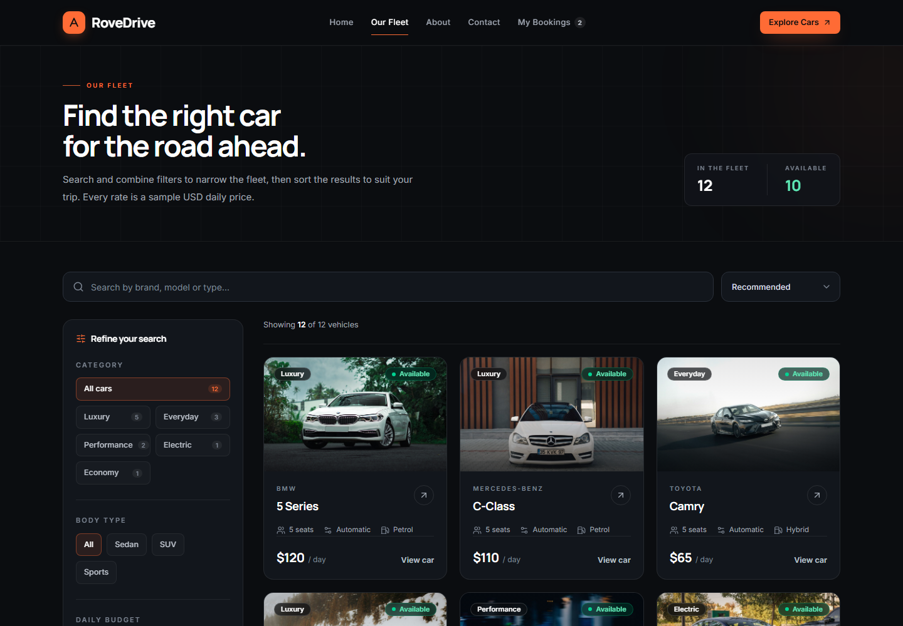
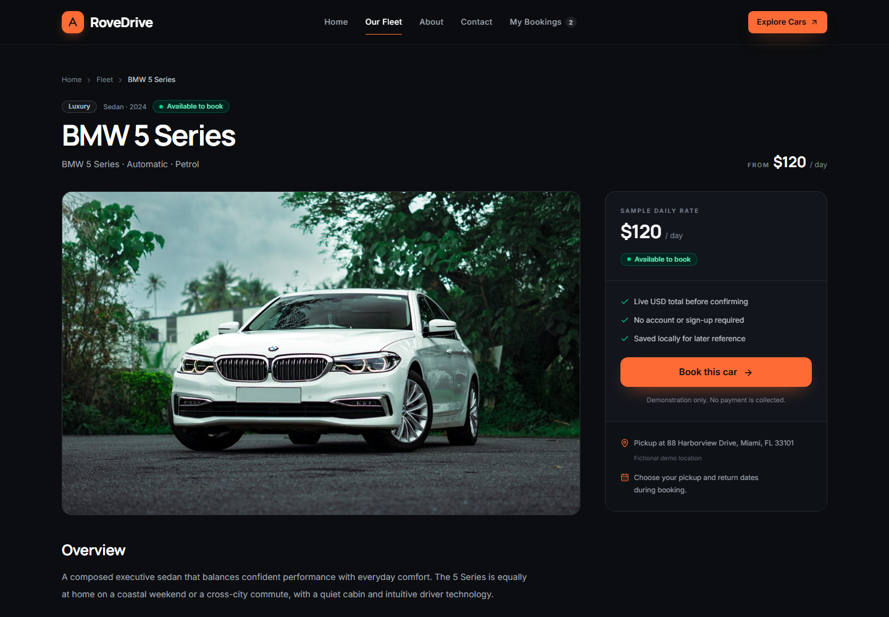
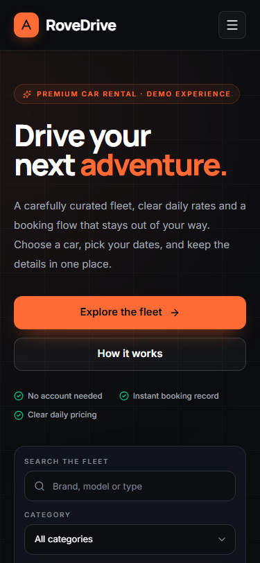

# RoveDrive

**Drive Your Next Adventure.**

RoveDrive is a responsive, portfolio-quality car rental frontend built with **React, Vite and Tailwind CSS**. It combines a premium dark automotive design with a complete demonstration booking experience, including fleet search and filtering, vehicle detail pages, date-based pricing, validated reservations and persistent booking history using LocalStorage.

> **Demo notice:** RoveDrive is a fictional frontend demonstration. All vehicles, prices, availability, contact details and rental policies are sample content. No real reservation, payment or rental agreement is created, and no data is sent to a server.

---

## Preview

| Home                                                     | Fleet                                                       |
| -------------------------------------------------------- | ----------------------------------------------------------- |
|  |  |

| Vehicle Details                                                    | Booking                                                         |
| ------------------------------------------------------------------ | --------------------------------------------------------------- |
|  |  |

| My Bookings                                                        | Mobile                                                   |
| ------------------------------------------------------------------ | -------------------------------------------------------- |
|  |  |

---

## Highlights

- **12 sample vehicles** across five categories and three body types, managed in a centralized data module.
- **Combined fleet search and filtering** by keyword, category, body type, maximum daily price and availability, with multiple sorting options.
- **Homepage search handoff** that passes keyword and category selections to the fleet page through URL query parameters.
- **Detailed vehicle pages** featuring specifications, equipment, sample rental terms, availability and related vehicles.
- **Validated booking flow** with custom name, email and phone validation, date checks and unavailable-vehicle guards.
- **Live USD price calculation** based on the selected rental dates and vehicle's daily rate.
- **Unique booking references** with collision checks and duplicate-booking prevention.
- **Persistent booking history** using LocalStorage (`rovedrive.bookings.v1`), including cross-tab synchronization.
- **Verified confirmation pages** that display success only when the booking reference exists in saved data.
- **Privacy-conscious booking history** that masks email addresses and does not display phone numbers.
- **Accessible interactions** including semantic landmarks, labelled fields, focus handling, confirmation dialogs, a skip link and reduced-motion support.
- **Responsive layouts** tested at 375, 768, 1024 and 1440 pixels.

---

## Tech Stack

| Area             | Technology                          |
| ---------------- | ----------------------------------- |
| UI               | React 19                            |
| Build Tool       | Vite 8                              |
| Styling          | Tailwind CSS 4                      |
| Routing          | React Router 7                      |
| Icons            | Lucide React                        |
| State Management | React Context API + Component State |
| Persistence      | Browser LocalStorage                |
| Fonts            | Inter + Manrope (Google Fonts)      |

**No backend, API, authentication, payment provider or database is involved.**

---

## Getting Started

### Prerequisites

- Node.js **20.19+** (or 22.12+)
- npm 10+

### Installation

Clone the repository and install dependencies:

```bash
git clone https://github.com/maviatahir/rovedrive.git
cd rovedrive
npm install
```

### Run Development Server

```bash
npm run dev
```

Open the local URL printed by Vite (usually `http://localhost:5173`).

### Production Build

```bash
npm run build
npm run preview
```

The production output is generated in the `dist/` directory.

### Lint

```bash
npm run lint
```

---

## Application Routes

| Route                            | Description                                                                                    |
| -------------------------------- | ---------------------------------------------------------------------------------------------- |
| `/`                              | Homepage with hero search, company introduction, featured cars, benefits, how it works and CTA |
| `/fleet`                         | Full vehicle fleet with combined search, filters and sorting                                   |
| `/cars/:id`                      | Vehicle details, specifications, features, rental information and booking CTA                  |
| `/booking/:id`                   | Reservation form, validation and live price summary                                            |
| `/booking-success?ref=RD-XXXXXX` | Confirmation page for a booking saved in LocalStorage                                          |
| `/my-bookings`                   | Saved booking history, empty state and clear-history action                                    |
| `*`                              | Custom 404 page                                                                                |

---

## Project Structure

```text
rovedrive/
├── docs/
│   └── screenshots/              # Desktop and mobile screenshots
├── public/
│   ├── images/
│   │   ├── cars/                 # 12 locally stored vehicle photos
│   │   └── hero.jpg              # Homepage hero photograph
│   ├── _redirects                # Netlify SPA fallback
│   ├── favicon.svg
│   ├── logo.svg
│   └── robots.txt
├── src/
│   ├── components/
│   │   ├── booking/              # Booking form, summary and booking card
│   │   ├── cars/                 # Cards, grid, filters, search and sorting
│   │   ├── common/               # Reusable UI components
│   │   └── layout/               # Navbar, footer and route layout
│   ├── context/
│   │   ├── BookingProvider.jsx   # Booking state, persistence and tab sync
│   │   └── bookingContext.js     # Context object and useBookings hook
│   ├── data/
│   │   ├── cars.js               # Central vehicle inventory and helpers
│   │   └── site.js               # Demo content and contact details
│   ├── hooks/
│   │   ├── useBodyScrollLock.js
│   │   ├── useCarFilters.js      # Filtering, sorting and facets
│   │   └── useDocumentTitle.js
│   ├── pages/                    # Route-level page components
│   ├── utils/
│   │   ├── booking.js            # Validation, pricing and references
│   │   ├── dates.js              # Local date-only helpers
│   │   ├── format.js             # Currency, date and masking helpers
│   │   ├── cn.js                 # Conditional class names
│   │   └── storage.js             # Safe LocalStorage operations
│   ├── App.jsx                   # Application route table
│   ├── index.css                 # Theme tokens and global styles
│   └── main.jsx                  # BrowserRouter and BookingProvider
├── .gitignore
├── index.html
├── package.json
├── package-lock.json
├── vite.config.js
├── vercel.json                   # Vercel SPA fallback
└── README.md
```

---

## How It Works

### Fleet Filtering

The `useCarFilters` hook manages filter state and derives the displayed vehicle list through a combined filtering pipeline:

1. **Search tokens** — every whitespace-separated token must match the vehicle's brand, model, display name, category, body type or fuel type.
2. **Category** — filters by Luxury, Everyday, Performance, Electric or Economy.
3. **Body type** — filters by Sedan, SUV or Sports.
4. **Maximum daily price** — excludes vehicles above the selected budget.
5. **Availability** — optionally shows only vehicles marked as available.
6. **Sorting** — supports recommended order, price ascending, price descending and name A–Z.

Filters work together rather than independently. The active-filter count excludes the search query, while the **Clear all** action resets both the query and filters.

The homepage search navigates to `/fleet?q=...&category=...`. The fleet page reads these parameters as its initial filter state, then manages subsequent interactions locally.

### Booking Lifecycle

1. The booking route checks whether the requested vehicle exists and is available.
2. Controlled form inputs update the booking values and live price summary.
3. Submission triggers custom validation for customer details, dates and vehicle state.
4. Invalid fields display inline errors, and the first invalid field receives focus.
5. A duplicate check blocks another booking with the same vehicle, dates and normalized email address.
6. A submission lock prevents accidental double submissions.
7. A unique `RD-XXXXXX` reference is generated and checked against saved references.
8. The booking record is written to LocalStorage before React state is updated.
9. If storage fails, an error is displayed and the success page is not shown.
10. After a successful save, the app navigates to `/booking-success?ref=...`.
11. The success page looks up the reference in saved bookings. Missing or unknown references display a fallback instead of a false confirmation.

### Dates and Pricing

The browser's date input returns `YYYY-MM-DD` strings. These are handled as local calendar dates to avoid timezone-related date shifts.

- Pickup cannot be in the past.
- Return must be at least one calendar day after pickup.
- Rental duration is calculated in whole calendar days.
- Total price = daily rate × rental days.
- Changing the pickup date clears an existing return date if it becomes invalid.

### Persistence and Privacy

- Storage key: `rovedrive.bookings.v1`
- Bookings are stored newest first.
- Saved records are validated when read; malformed records are ignored.
- Corrupt payloads are handled safely without breaking app startup.
- A browser `storage` event listener synchronizes booking changes across tabs.
- The booking form and confirmation data are stored locally for the demo.
- My Bookings displays the driver's name and a masked email address, but does not display the phone number.
- Clearing booking history requires confirmation and cannot be undone.

### Example Booking Record

```json
{
  "reference": "RD-K7M2QX",
  "carId": "bmw-5-series",
  "car": {
    "id": "bmw-5-series",
    "name": "BMW 5 Series",
    "brand": "BMW",
    "model": "5 Series",
    "category": "Luxury",
    "type": "Sedan",
    "pricePerDay": 120,
    "image": "/images/cars/bmw-5-series.jpg"
  },
  "customer": {
    "fullName": "Alex Morgan",
    "email": "alex@example.com",
    "phone": "+1 (555) 010-4820"
  },
  "pickupDate": "2026-12-01",
  "returnDate": "2026-12-04",
  "rentalDays": 3,
  "dailyRate": 120,
  "total": 360,
  "createdAt": "2026-11-19T12:00:00.000Z"
}
```

---

## Validation Rules

| Field             | Validation                                                                     |
| ----------------- | ------------------------------------------------------------------------------ |
| Full Name         | Required, 2–80 characters                                                      |
| Email             | Required, basic `name@example.com` pattern                                     |
| Phone             | Required, 7–15 digits; supports `+`, digits, spaces, brackets, dots and dashes |
| Pickup Date       | Required, valid calendar date and cannot be in the past                        |
| Return Date       | Required, valid calendar date and at least one day after pickup                |
| Vehicle           | Must exist and be marked as available                                          |
| Duplicate Booking | Same vehicle, pickup date, return date and normalized email are blocked        |

Validation is handled by custom application logic rather than browser tooltips. The form uses `noValidate` to keep error messages and focus behaviour consistent.

---

## Manual QA

The following application flows were manually tested at **375, 768, 1024 and 1440 pixels**:

- All seven routes and an unknown URL.
- Homepage navigation, hero CTAs, section links, featured cards and footer links.
- Homepage search to fleet query/category handoff.
- Keyword search, categories, body types, price slider, availability toggle and sorting.
- Combined filters, empty results, reset filters and active-filter count.
- Valid and invalid vehicle IDs on details and booking routes.
- Booking validation for blank fields, malformed email, phone length, past pickup and invalid return dates.
- Live price updates and pickup-date/return-date clearing behaviour.
- Successful booking, reference display and persistence after refresh.
- Duplicate submission and duplicate-record prevention.
- Booking success with valid, missing and unknown references.
- My Bookings empty and populated states, masked contact details and clear-history confirmation.
- Mobile navigation, Escape handling, skip link, keyboard focus, modal focus trap and reduced-motion preference.
- Production build, preview server and direct-route refresh with SPA fallback.

See [LEARNING_GUIDE.md](LEARNING_GUIDE.md) for a step-by-step walkthrough of the architecture and implementation.

---

## Accessibility

- Semantic `header`, `nav`, `main`, `section`, `article` and `footer` landmarks.
- Skip-to-content link and visible `:focus-visible` indicators.
- Labelled form fields with inline errors connected through `aria-describedby` and `aria-invalid`.
- Error summary focus and first-invalid-field focus on submission.
- Accessible confirmation dialog with `role="dialog"`, `aria-modal`, Escape handling, focus trapping and focus restoration.
- Mobile navigation closes with Escape and restores focus to its trigger.
- Toast notifications use appropriate status and alert roles with live announcements.
- Status indicators use text as well as colour.
- Date inputs support a dark colour scheme, and reduced-motion preferences disable animations.
- Images include descriptive alternative text; decorative overlays are hidden from assistive technology.

---

## Known Limitations

- **Frontend-only demo:** No backend, database, authentication, email delivery or payment processing.
- **Demo availability:** Vehicle availability is a single sample flag, not date-specific inventory. Overlapping bookings for the same vehicle are not checked.
- **Device-local bookings:** Clearing browser storage removes saved bookings. They do not sync across browsers or devices.
- **Local references:** Booking references are unique within the current browser's saved history, not globally.
- **Static sample data:** Prices, specifications, contact details, policies and statistics are fictional.
- **Illustrative photography:** Images may not exactly match the listed vehicle trim or specification.
- **No automated test suite:** Testing was performed manually; the utility modules are structured to support future unit tests.
- **Demo social links:** Social links point to the platforms' home pages.

---

## Deployment

RoveDrive uses `BrowserRouter`, so production hosting must serve `index.html` for application routes that do not correspond to physical files.

- **Netlify:** `public/_redirects` provides the SPA fallback and is copied into the production build.
- **Vercel:** `vercel.json` contains a catch-all rewrite to `index.html`.
- **Other static hosts:** Configure an SPA fallback/rewrite to `/index.html` and deploy the `dist/` directory.

### Build Settings

| Setting           | Value           |
| ----------------- | --------------- |
| Build command     | `npm run build` |
| Publish directory | `dist`          |

---

## Image Credits and Demo Content

Vehicle and hero photography is sourced from [Pexels](https://www.pexels.com/) and stored locally in `public/images/` so the demo remains stable and does not depend on remote image loading at runtime.

Images are used as illustrative placeholders under the [Pexels License](https://www.pexels.com/license/). They do not represent an endorsement by the photographers or vehicle manufacturers.

All vehicle names, prices, availability, contact details, policies and statistics in the UI are demonstration content. Brand and model names are trademarks of their respective owners.

---

## GitHub Repository

[github.com/maviatahir/rovedrive](https://github.com/maviatahir/rovedrive)

**Repository description:**

> A premium car rental frontend demo built with React, Vite and Tailwind CSS, featuring fleet filtering, validated bookings and LocalStorage history.

---

**RoveDrive — Drive Your Next Adventure.**
